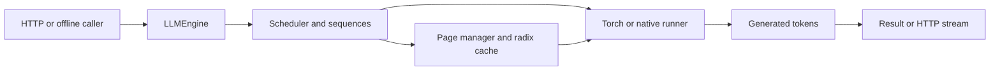
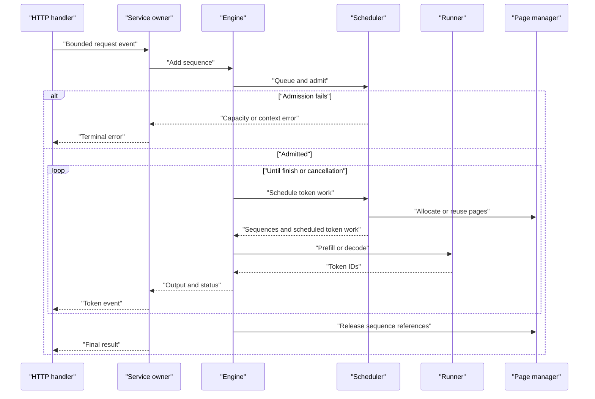

# LLM serving engine

An MIT-licensed extension of [GeeeekExplorer/nano-vllm](https://github.com/GeeeekExplorer/nano-vllm), preserving its full Git history, license, Qwen3 model and offline API. This project adds a portable PyTorch paged-attention backend, bounded scheduling, exact page radix caching, and a local HTTP server. [Provenance and limitations](docs/provenance.md) describe the coursework relationship and source boundaries. The [original README](docs/upstream-README.md) retains upstream descriptions and benchmark attribution.

## Contents

- [Run locally](#run-locally)
- [Offline API](#offline-api)
- [Architecture and execution guide](#architecture-and-execution-guide)
- [Mechanisms](#mechanisms)
- [Verify and measure](#verify-and-measure)

## Architecture and execution guide

The repository preserves nano-vLLM's offline API and Qwen3 path, with a portable Torch runner, paged KV allocation, bounded scheduling, and a loopback HTTP service. The optional Linux CUDA backend is a separate path. A [KV page](#kv-page) stores token attention state; the [radix cache](#radix-cache) reuses exact prefixes.

The top-level diagram shows the engine boundary and its model runner.



This sequence follows one HTTP request. Capacity errors occur before generation; cancellation releases active page references.



| Subsystem | Responsibility and owned state | Source |
| --- | --- | --- |
| Engine | Owns sequence IDs, runner, scheduler, and offline request/step API. | [`llm_engine.py`](nanovllm/engine/llm_engine.py) |
| Scheduler | Queues prompts, admits requests, budgets prefill/decode work, and cancels sequences. | [`scheduler.py`](nanovllm/engine/scheduler.py) |
| Pages and cache | Maps token positions to physical pages, pins active references, and evicts only unpinned leaves. | [`block_manager.py`](nanovllm/engine/block_manager.py) |
| Runner | Executes model layers through the portable Torch runner or the optional native CUDA runner. | [`model_runner.py`](nanovllm/engine/model_runner.py), [`torch_runner.py`](nanovllm/engine/torch_runner.py) |
| HTTP service | Owns one engine, bounded client events, streaming, deadlines, and cancellation. | [`server.py`](nanovllm/server.py) |

Execution journey:

1. An offline caller invokes `add_request`, or an HTTP handler validates a bounded body and sends an event to the service owner.
2. The engine creates a sequence and submits it to the scheduler.
3. The scheduler admits it only when context and reserved maximum KV footprint fit. Rejection returns an error.
4. The scheduler selects [prefill](#prefill) or [decode](#decode) within the token budget. The page manager allocates pages or reuses exact full-page matches from the [radix cache](#radix-cache).
5. The runner returns token IDs. The engine updates sequence state and the HTTP service emits output events.
6. Completion, cancellation, or deadline failure removes the sequence and releases its [KV page](#kv-page) references.

| Choice | Current behavior and rationale inferred from code | Alternative and cost to reconsider |
| --- | --- | --- |
| Use one owner per engine | Process-global attention context requires serialized engine operations. | Concurrent operations require context isolation or wider locking. |
| Reserve maximum request footprint | Every admitted sequence can finish without preemption. | Incremental admission can improve use but requires preemption or allocation recovery. |
| Match exact full pages | Token tuples and exact parents avoid approximate prefix matches. | Partial-page reuse may save work but complicates matching and boundaries. |
| Pin pages while active | Eviction only removes unpinned LRU leaves. | Active eviction needs copying or reconstruction rules. |
| Bound HTTP resources | Client count, event queue, body size, and deadline cap request resources. | Unbounded queues can accumulate memory and waiting clients. |

These are implementation tradeoffs, not historical intent. The local loopback service does not claim full OpenAI protocol compatibility or production access controls.

<a id="kv-page"></a>

<details><summary>What is a KV page?</summary>

A KV page stores key and value attention tensors for a token block. The default block has 16 tokens and the configured page pool is fixed.

</details>

<a id="radix-cache"></a>

<details><summary>What is a radix cache?</summary>

A radix cache indexes exact token prefixes in a tree. This engine adds only complete processed pages and pins pages held by active sequences.

</details>

<a id="prefill"></a>

<details><summary>What is prefill?</summary>

Prefill computes model state for prompt tokens before generation. The scheduler chunks it to fit the token budget.

</details>

<a id="decode"></a>

<details><summary>What is decode?</summary>

Decode chooses the next token from prior context. Budget-limited scheduling rotates live requests.

</details>

<a id="sequence-admission"></a>

<details><summary>What is sequence admission?</summary>

Admission checks that context and maximum KV page needs fit before a sequence runs. A request that cannot reserve its footprint is rejected.

</details>

## Run locally

Use Python 3.10 through 3.12 and a local Qwen3 safetensors checkpoint. The loader never downloads weights or loads pickle checkpoints.

```bash
python -m pip install -e .
python -m nanovllm.server --model /path/to/qwen3 --device cpu --eager
```

For a CUDA-enabled PyTorch installation, use `--device cuda`. Decode graphs are enabled on CUDA unless `--eager` is set. The server defaults to four concurrent running sequences, a 64-token step budget, 64 pages of 16 tokens, 16 HTTP clients, 16 queued client events, a 64 KiB body limit, and a 120-second request deadline. Requests must fit both the model context and the fixed page pool. The server binds to loopback by default.

```bash
curl http://127.0.0.1:8000/v1/completions -H "Content-Type: application/json" -d '{"prompt":"Hello","max_tokens":16,"temperature":0,"stream":true}'
```

`POST /v1/chat/completions` accepts text messages through the model's local chat template. This is a small JSON API, with custom SSE token events and a final full-result event followed by `[DONE]`. It does not claim full OpenAI protocol compatibility. Cancel a streaming request with `DELETE /requests/<request_id>` using the ID from its first event. `/health` and `/metrics` expose bounded lifecycle and page statistics.

The CLI accepts only numeric IPv4 loopback addresses for `--host`.

## Offline API

```python
from nanovllm import LLM, SamplingParams

llm = LLM("/path/to/qwen3", device="cuda", max_num_seqs=4,
          max_model_len=512, kvcache_block_size=16, num_kvcache_blocks=64)
try:
    outputs = llm.generate(["Hello"], SamplingParams(temperature=0, max_tokens=16))
    print(outputs[0]["text"])
finally:
    llm.exit()
```

`add_request` returns a sequence ID. `step` preserves the upstream `(finished_outputs, signed_token_count)` result. `cancel_request` releases that request's page references. `generate` refills the bounded queue for larger input lists. Temperature zero selects greedy decoding, and zero requested tokens complete immediately. Each engine requires one owner thread because upstream attention context is process-global.

## Mechanisms

Packed prefill runs projections and MLPs on real tokens only. Attention scatters KV into physical pages and gathers through page tables. Absolute query positions preserve causal masking across cached prefixes and prefill chunks. The token budget bounds both prefill and decode work. Eligible prefill and decode phases alternate, and budget-limited decode rotates live requests. Admission conservatively reserves each live request's maximum KV footprint so all admitted requests can finish without preemption.

The radix tree stores exact full-page token tuples under their exact parent. Complete processed generation pages enter the same tree as prompt pages. Sequence references pin pages. Eviction removes only unpinned LRU leaves. Cached pages remain reusable after completion, while active page references return to zero. Decode graphs use stable buffers and covering batch buckets. Padding writes to reserved scratch slots, and every replay replaces all page-table columns and inactive lane metadata.

The original native attention kernels remain in `native_attention.py`. Install `.[native]` on a compatible Linux CUDA system and select `backend="native", device="cuda"` to use the upstream flash-attn, Triton and NCCL path. That backend and tensor parallelism have not been executed in this Windows validation. `compile=True` or `--compile` opts into PyTorch compilation of norm, rotary, activation and sampling regions. Compiler availability and compile performance remain unverified here.

## Verify and measure

The maintained [verification skill](.agents/skills/verify-serving/SKILL.md) records launch, doctor, drive, evidence and cleanup. It covers independent Hugging Face forward parity, page conservation, cache pressure, fairness, slow-client cancellation and real HTTP lifecycles.

```bash
python -m unittest discover -s tests -v
python tools/verify_serving.py --device cpu --output evidence/cpu-runtime.json
python tools/verify_serving.py --device cuda --model /path/to/qwen3 --output evidence/cuda-runtime.json
python bench.py --model /path/to/qwen3 --device cuda --concurrency 3 --requests 8 --input-length 24 --output-length 8 --repeats 5
```

The benchmark records actual output counts, errors, per-run times, hardware and cache policy. It includes scheduler, sampling and model execution in `generate`, with an unmeasured warmup. Synthetic token-ID prompts exclude tokenization. Compare configurations with interleaved repeated runs and representative prompts before making a performance claim. Local sample evidence is not a standardized benchmark, a speedup result, or completion of Stanford's grader.

The retained [CUDA verification](docs/results/cuda-verification.json) records independent HF greedy parity, eager/graph parity, three live requests in a four-lane graph bucket, cache eviction and HTTP cancellation with zero active pages afterward. The [five-run local measurement](docs/results/cuda-throughput.json) retains all timings, output counts and errors. These copies normalize machine-specific model/executable paths; local originals remain unchanged. The later telemetry-storage correction changes no numerical execution and was checked with the CPU replay regression and HTTP driver. Hosted CI runs CPU checks and uploads its actual HTTP evidence; it does not run the pretrained CUDA workload.

A later [Torch Timer comparison](docs/evidence/torch-metrics-20261022/sdpa-summary.json) measured two fixed offline workloads on an RTX 5080 Laptop GPU, Torch 2.11.0+cu128 and Transformers 5.20.2. Both used 16 prompts, pinned Qwen3-0.6B weights in BF16, native HF SDPA and paged SDPA; the independent token oracle uses single-request eager full forwards. The first point used 128 input tokens, exactly 32 outputs and maximum live batch 4. The second used 256 input tokens, exactly 64 outputs and maximum live batch 1. Each retained case has five Timer trials per arm with two automatic warmups per trial, rotating arm order and no prefix reuse. All 15 calls per arm (warmups and measured trials) matched the oracle exactly. Model loading/oracle construction are excluded; generation, text decoding, native input transfer, paged scheduler reset and token checks are included. Raw results, token oracles and supervisor receipts are retained with the summary.

| Workload | Arm | Batch completion median [range], seconds | Median output tokens/s |
|---|---|---:|---:|
| 128 / 32 / batch 4 | Native Transformers `generate`, SDPA | 3.180 [3.177–3.240] | 161.0 |
| 128 / 32 / batch 4 | Portable paged eager, SDPA | 3.648 [3.608–4.172] | 140.3 |
| 128 / 32 / batch 4 | Portable paged decode graphs, SDPA | 1.192 [1.182–1.226] | 429.6 |
| 256 / 64 / batch 1 | Native Transformers `generate`, SDPA | 23.587 [23.475–24.886] | 43.4 |
| 256 / 64 / batch 1 | Portable paged eager, SDPA | 26.191 [26.063–26.385] | 39.1 |
| 256 / 64 / batch 1 | Portable paged decode graphs, SDPA | 6.903 [6.843–6.965] | 148.3 |

For each point, all 240 measured requests completed without errors, with zero prefix hits and zero active pages afterward. At 128 / 32 / batch 4, total peak CUDA allocation was 5,145,931,264 bytes and sampled process-tree RSS peaked at 2,594,988,032 bytes. At 256 / 64 / batch 1, total peak CUDA allocation was 5,108,968,960 bytes and sampled process-tree RSS peaked at 2,282,287,104 bytes. The respective native batch cache sizes were 72,941,568 and 36,585,472 bytes; paged pool plus scratch sizes were 75,235,328 and 38,535,168 bytes. These two observations do not form a service-capacity sweep or a general inference-framework ranking. A separate unchanged graph-arm profile contains four prefill and 124 decode calls; its overlapping CUDA annotation percentages cannot be interpreted as additive latency shares or causal attribution of the timing differences.

The 256 / 64 / batch 1 long case ran with an external 1,800-second cap; its complete raw receipt is retained alongside the 128 / 32 / batch 4 case. Only two of the proposed 24 workload cells have been measured. Reproduce either point with `python tools/benchmark_serving.py --model <cached-pinned-Qwen-directory> --output evidence/<fresh-id> --input-length <128-or-256> --output-length <32-or-64> --concurrency <4-or-1>` under an exclusive CUDA grant and the matching external cap. The [measurement contract](.agents/skills/verify-serving/features/metrics.md) records exact EOS/backend/cache policies, prior failed receipts and the separate Locust boundary. The earlier native-HF-eager timing is retained as an untuned historical control; it is not the SDPA comparator above.
