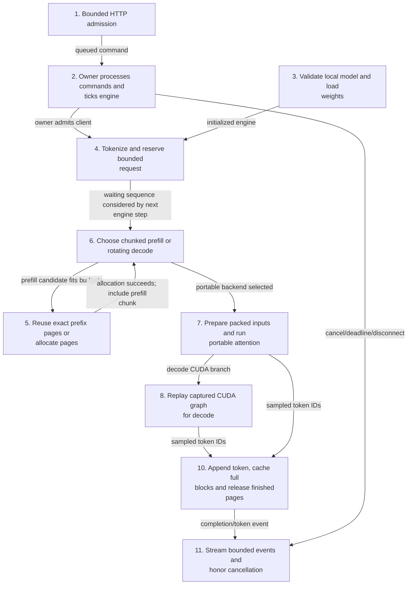
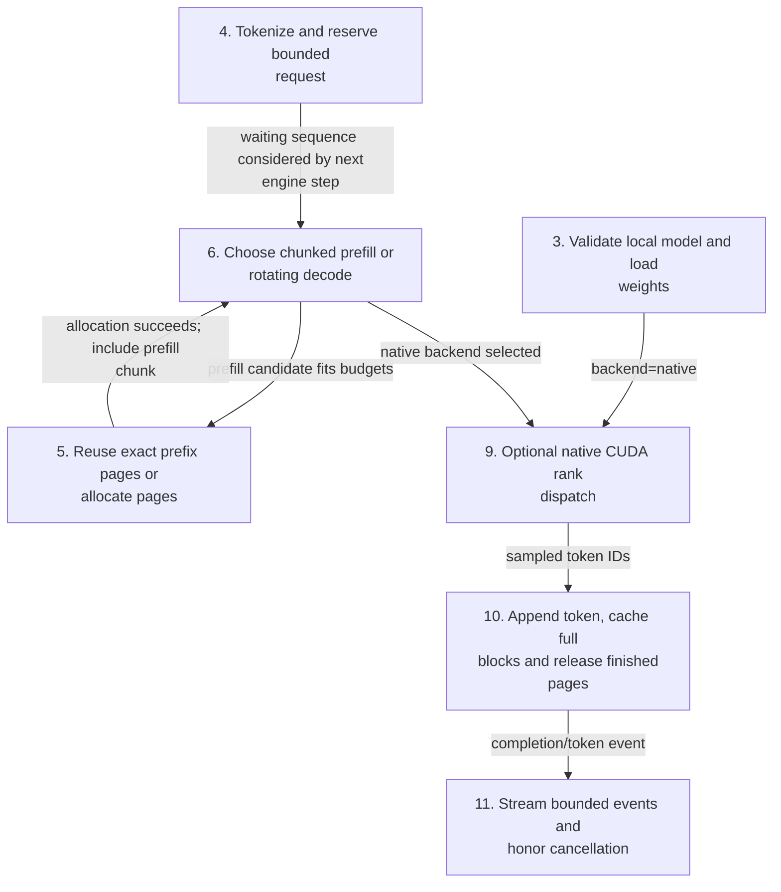
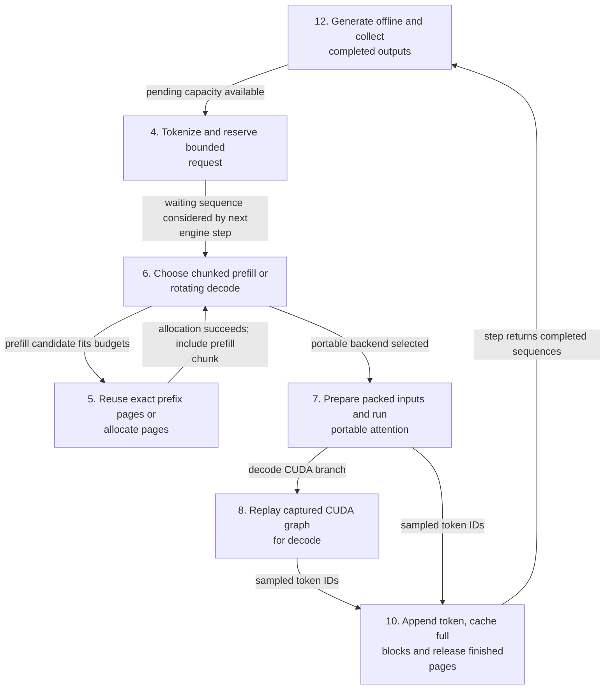
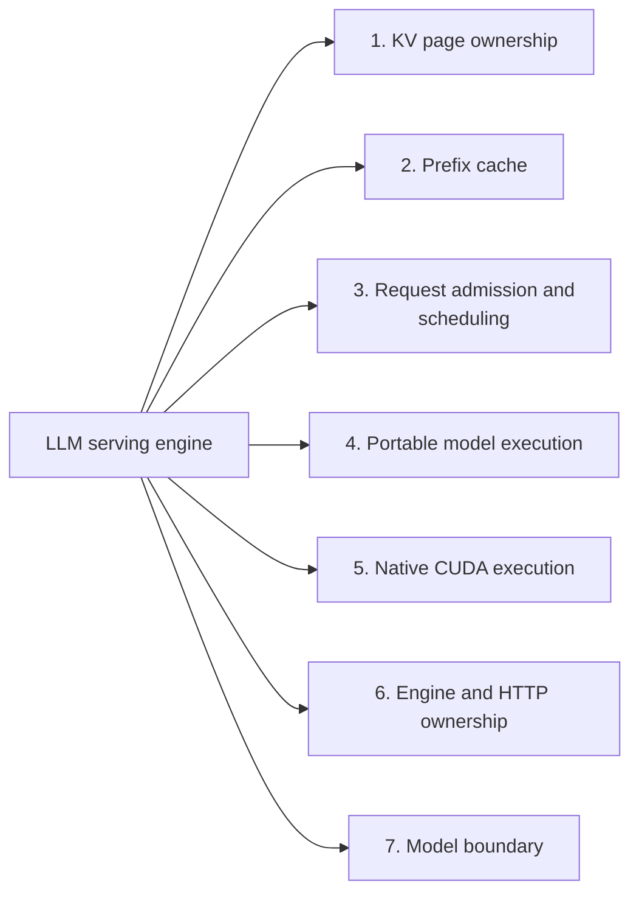
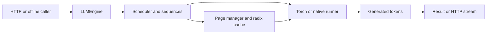
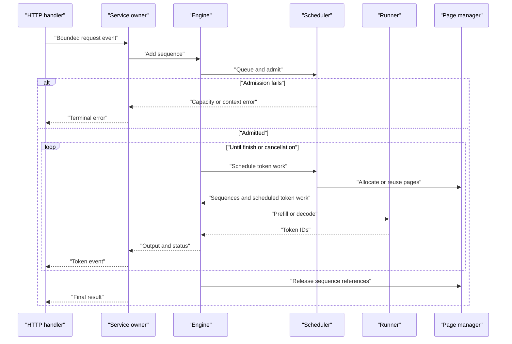

# LLM serving engine

An MIT-licensed extension of [GeeeekExplorer/nano-vllm](https://github.com/GeeeekExplorer/nano-vllm), preserving its full Git history, license, Qwen3 model and offline API. This project adds a portable PyTorch paged-attention backend, bounded scheduling, exact page radix caching, and a local HTTP server. [Provenance and limitations](docs/provenance.md) describe the coursework relationship and source boundaries. The [original README](docs/upstream-README.md) retains upstream descriptions and benchmark attribution.

## Contents

- [Run locally](#run-locally)
- [Offline API](#offline-api)
- [Architecture and execution guide](#architecture-and-execution-guide)
- [Mechanisms](#mechanisms)
- [Implementation techniques](#implementation-techniques)
- [Verify and measure](#verify-and-measure)

## Architecture and execution guide

<!-- execution-flow:start -->
### Execution flow

Start with the primary path, then expand a detailed workflow. Select a numbered node to see its operation, implementation techniques, and source. Solid arrows show the named control, data, or lifecycle handoff; dotted arrows show error paths. Separate entry points are named in each workflow.

<a id="review-walkthrough"></a>

#### Walk through one concrete example

Send a bounded HTTP generation request for a locally installed supported Qwen3 model to the portable PyTorch backend.

**Trace.** [Bounded HTTP admission](#flow-step-http-admit) → [Owner processes commands and ticks engine](#flow-step-owner-loop) → [Tokenize and reserve bounded request](#flow-step-request-admit) → [Choose chunked prefill or rotating decode](#flow-step-schedule) → [Prepare packed inputs and run portable attention](#flow-step-portable-run) → [Replay captured CUDA graph for decode](#flow-step-decode-graph) → [Append token, cache full blocks and release finished pages](#flow-step-postprocess).

**Result and boundary.** An admitted sequence reuses exact cached prefix pages where available, runs portable attention, and advances or releases KV page references as it generates; queue saturation returns 429, and native CUDA is a separate unexecuted source-described mode.

<details>
<summary>Implementation decisions to explain</summary>

**Why reserve the maximum KV footprint before waiting for admission?** The engine checks whether the request's bounded context can fit before it starts consuming shared page capacity; this gives predictable admission bounds but can reject a request whose eventual output would be shorter.

[Maximum-footprint reservation](#technique-maximum-footprint-reservation) · [Reference-counted KV page sharing](#technique-kv-page-reference-counting).

**Why cache only exact full token blocks in the radix prefix cache?** Exact block matches make page reuse correspond to identical token prefixes; partially matching tails do not qualify and must be allocated or computed normally.

[Exact radix prefix lookup](#technique-exact-radix-prefix-cache).

</details>

#### Primary execution flow

HTTP request enters bounded queues, is admitted by the single engine owner, scheduled through portable execution, and returned as events; offline generate shares engine/scheduler but bypasses HTTP.



**Detailed workflows.** [HTTP portable request lifecycle](#flow-workflow-http-portable-lifecycle) · [Optional native CUDA and tensor parallel mode](#flow-workflow-native-cuda-mode) · [Offline portable generation](#flow-workflow-offline-portable-generation).

<a id="flow-workflow-http-portable-lifecycle"></a>

<details>
<summary>HTTP portable request lifecycle</summary>

HTTP entry, serialized engine ownership, bounded scheduling, portable model execution, event streaming and cancellation.


</details>

<a id="flow-workflow-native-cuda-mode"></a>

<details>
<summary>Optional native CUDA and tensor parallel mode</summary>

Native backend has no runtime fallback to Torch; rank workers use NCCL and shared-memory command dispatch. Described from source, not executed in the recorded environment.



</details>

<a id="flow-workflow-offline-portable-generation"></a>

<details>
<summary>Offline portable generation</summary>

Independent LLMEngine.generate entrypoint uses shared admission, scheduling and runner paths without HTTP event delivery. Native backend uses the separately documented native-run branch.



</details>

#### Steps, techniques, and source

These source traces cover the active scope below. They explain implementation behavior; benchmark results and their limits remain in the measurement sections.

<a id="flow-step-http-admit"></a>

##### 1. Bounded HTTP admission

**Component.** Handler.do_POST. Validate route, bounded Content-Length and JSON shape, enqueue a client into a bounded command queue; queue saturation returns 429.

**Techniques at this step.** [Bounded HTTP admission and streaming cancellation](#technique-bounded-http-streaming-and-cancellation).

**Source.** [`nanovllm/server.py:192`](https://github.com/STEVVVU/llm-serving-engine/blob/main/nanovllm/server.py#L192). [Back to execution flow](#execution-flow).

<a id="flow-step-owner-loop"></a>

##### 2. Owner processes commands and ticks engine

**Component.** Service.run. A dedicated model-owner thread drains cancellations and commands, advances the engine, publishes events, and owns engine shutdown.

**Techniques at this step.** [Single-owner engine command loop](#technique-single-owner-engine-command-loop).

**Source.** [`nanovllm/server.py:120`](https://github.com/STEVVVU/llm-serving-engine/blob/main/nanovllm/server.py#L120). [Back to execution flow](#execution-flow).

<a id="flow-step-model-boundary"></a>

##### 3. Validate local model and load weights

**Component.** Config.__post_init__ / load_model. Configuration requires a local directory, supported Qwen3 shape and backend constraints; loader reads safetensors and rejects empty or incomplete checkpoints.

**Techniques at this step.** [Local safetensors-only loading](#technique-local-safetensors-only-loading).

**Source.** [`nanovllm/config.py:25`](https://github.com/STEVVVU/llm-serving-engine/blob/main/nanovllm/config.py#L25) · [`nanovllm/utils/loader.py:12`](https://github.com/STEVVVU/llm-serving-engine/blob/main/nanovllm/utils/loader.py#L12). [Back to execution flow](#execution-flow).

<a id="flow-step-request-admit"></a>

##### 4. Tokenize and reserve bounded request

**Component.** LLMEngine.add_request / Scheduler.add. Strings are locally tokenized and token IDs validated; pending count, context length and maximum KV footprint are checked before waiting admission.

**Techniques at this step.** [Maximum-footprint reservation](#technique-maximum-footprint-reservation).

**Source.** [`nanovllm/engine/scheduler.py:23`](https://github.com/STEVVVU/llm-serving-engine/blob/main/nanovllm/engine/scheduler.py#L23) · [`nanovllm/engine/llm_engine.py:51`](https://github.com/STEVVVU/llm-serving-engine/blob/main/nanovllm/engine/llm_engine.py#L51). [Back to execution flow](#execution-flow).

<a id="flow-step-prefix-allocate"></a>

##### 5. Reuse exact prefix pages or allocate pages

**Component.** BlockManager.can_allocate / allocate. Full cached token blocks are matched along radix children; matching pages gain references and remaining pages are allocated, failing admission when capacity is insufficient.

**Techniques at this step.** [Exact radix prefix lookup](#technique-exact-radix-prefix-cache) · [Reference-counted KV page sharing](#technique-kv-page-reference-counting).

**Source.** [`nanovllm/engine/block_manager.py:86`](https://github.com/STEVVVU/llm-serving-engine/blob/main/nanovllm/engine/block_manager.py#L86). [Back to execution flow](#execution-flow).

<a id="flow-step-schedule"></a>

##### 6. Choose chunked prefill or rotating decode

**Component.** Scheduler.schedule. Prefill receives remaining token budget in bounded chunks; when no prefill is scheduled, running sequences rotate through one-token decode slots.

**Techniques at this step.** [Chunked prefill and rotating decode](#technique-chunked-prefill-and-rotating-decode).

**Source.** [`nanovllm/engine/scheduler.py:51`](https://github.com/STEVVVU/llm-serving-engine/blob/main/nanovllm/engine/scheduler.py#L51). [Back to execution flow](#execution-flow).

<a id="flow-step-portable-run"></a>

##### 7. Prepare packed inputs and run portable attention

**Component.** TorchRunner.prepare / Attention.forward. TorchRunner packs token positions, slot mappings and block tables. Torch Attention writes KV pages, gathers cached keys and values, and calls scaled_dot_product_attention with causal prefill or length-bounded decode masks.

**Techniques at this step.** [Packed prefill and paged SDPA](#technique-packed-prefill-and-paged-sdpa).

**Source.** [`nanovllm/engine/torch_runner.py:50`](https://github.com/STEVVVU/llm-serving-engine/blob/main/nanovllm/engine/torch_runner.py#L50) · [`nanovllm/layers/attention.py:16`](https://github.com/STEVVVU/llm-serving-engine/blob/main/nanovllm/layers/attention.py#L16). [Back to execution flow](#execution-flow).

<a id="flow-step-decode-graph"></a>

##### 8. Replay captured CUDA graph for decode

**Component.** TorchRunner.logits / capture_cudagraph. On CUDA decode with captured graphs, inputs and context are copied into a batch bucket and replayed; other paths execute the model eagerly.

**Techniques at this step.** [Decode CUDA graph replay](#technique-decode-cuda-graph-replay).

**Source.** [`nanovllm/engine/torch_runner.py:69`](https://github.com/STEVVVU/llm-serving-engine/blob/main/nanovllm/engine/torch_runner.py#L69). [Back to execution flow](#execution-flow).

<a id="flow-step-native-run"></a>

##### 9. Optional native CUDA rank dispatch

**Component.** ModelRunner.call / run. Native configuration initializes NCCL ranks; rank zero broadcasts calls through shared memory/events and native attention writes paged KV then dispatches flash-attention kernels. This path is source-described and unexecuted in the recorded Windows environment.

**Techniques at this step.** [Native paged attention and rank dispatch](#technique-native-paged-attention-and-rank-dispatch).

**Source.** [`nanovllm/engine/model_runner.py:88`](https://github.com/STEVVVU/llm-serving-engine/blob/main/nanovllm/engine/model_runner.py#L88). [Back to execution flow](#execution-flow).

<a id="flow-step-postprocess"></a>

##### 10. Append token, cache full blocks and release finished pages

**Component.** Scheduler.postprocess / BlockManager.deallocate. Scheduled tokens are hashed into radix cache, sequence cache progress advances, and EOS/length completion releases page references; zero-reference cached leaves may later be evicted by LRU when allocation needs space.

**Techniques at this step.** [LRU leaf eviction](#technique-lru-leaf-eviction) · [Reference-counted KV page sharing](#technique-kv-page-reference-counting).

**Source.** [`nanovllm/engine/scheduler.py:86`](https://github.com/STEVVVU/llm-serving-engine/blob/main/nanovllm/engine/scheduler.py#L86). [Back to execution flow](#execution-flow).

<a id="flow-step-stream-cancel"></a>

##### 11. Stream bounded events and honor cancellation

**Component.** Service.tick / Handler.do_DELETE. New tokens enter bounded client event queues; overflow, disconnect, deadline or DELETE marks cancellation and owner-side terminal handling cancels the engine sequence and publishes a terminal event.

**Techniques at this step.** [Bounded HTTP admission and streaming cancellation](#technique-bounded-http-streaming-and-cancellation).

**Source.** [`nanovllm/server.py:41`](https://github.com/STEVVVU/llm-serving-engine/blob/main/nanovllm/server.py#L41). [Back to execution flow](#execution-flow).

<a id="flow-step-offline-generate"></a>

##### 12. Generate offline and collect completed outputs

**Component.** LLMEngine.generate. The offline API fills the bounded pending queue, repeatedly calls step, collects finished sequence token IDs and decodes results in sequence-ID order. It bypasses HTTP commands, client event queues and cancellation transport.

This is the public offline consumer loop for the shared scheduling and execution mechanisms.

**Source.** [`nanovllm/engine/llm_engine.py:83`](https://github.com/STEVVVU/llm-serving-engine/blob/main/nanovllm/engine/llm_engine.py#L83). [Back to execution flow](#execution-flow).

<details>
<summary>Scope and subsystem coverage</summary>

Portable Torch request lifecycle from local model validation and HTTP/offline admission through scheduler, KV pages, prefill/decode, streaming/cancellation and release; optional native CUDA/Tensor Parallel implementation source-described only.

- **KV page ownership.** Allocation increments shared references; release decrements them. [Step 5](#flow-step-prefix-allocate), [Step 10](#flow-step-postprocess).
- **Prefix cache.** Exact full-block lookup and LRU leaf eviction are included. [Step 5](#flow-step-prefix-allocate), [Step 10](#flow-step-postprocess).
- **Request admission and scheduling.** Maximum footprint checks and bounded prefill/decode selection. [Step 4](#flow-step-request-admit), [Step 6](#flow-step-schedule).
- **Portable model execution.** Packed prefill/paged attention and optional decode graph replay. [Step 7](#flow-step-portable-run), [Step 8](#flow-step-decode-graph).
- **Native CUDA execution.** Optional source-described rank dispatch and paged attention; unexecuted. [Step 9](#flow-step-native-run).
- **Engine and HTTP ownership.** Bounded HTTP queues and owner-thread command/tick lifecycle. [Step 1](#flow-step-http-admit), [Step 2](#flow-step-owner-loop), [Step 11](#flow-step-stream-cancel).
- **Model boundary.** Local safetensors and supported configuration validation. [Step 3](#flow-step-model-boundary).

Outside this flow audit:

- `docs/upstream-README.md and examples`. Not active serving code.
- `native execution runtime verification`. No supported native runtime execution in recorded Windows environment.

</details>

<!-- execution-flow:end -->

<details>
<summary>Subsystem technique index</summary>

### Subsystem map

Select a subsystem in the diagram to open its techniques, tradeoffs, and code references. The numbered links provide the same navigation. This map groups components; the execution diagrams show their runtime flow.



1. [KV page ownership](#subsystem-kv-page-ownership)
2. [Prefix cache](#subsystem-prefix-cache)
3. [Request admission and scheduling](#subsystem-request-admission-and-scheduling)
4. [Portable model execution](#subsystem-portable-model-execution)
5. [Native CUDA execution](#subsystem-native-cuda-execution)
6. [Engine and HTTP ownership](#subsystem-engine-and-http-ownership)
7. [Model boundary](#subsystem-model-boundary)

The repository preserves nano-vLLM's offline API and Qwen3 path, with a portable Torch runner, paged KV allocation, bounded scheduling, and a loopback HTTP service. The optional Linux CUDA backend is a separate path. A [KV page](#kv-page) stores token attention state; the [radix cache](#radix-cache) reuses exact prefixes.

The top-level diagram shows the engine boundary and its model runner.

</details>

<details>
<summary>Expand flow diagram 1</summary>



</details>

This sequence follows one HTTP request. Capacity errors occur before generation; cancellation releases active page references.

<details>
<summary>Expand flow diagram 2</summary>



</details>

| Subsystem | Responsibility and owned state | Source |
| --- | --- | --- |
| Engine | Owns sequence IDs, runner, scheduler, and offline request/step API. | [`llm_engine.py`](nanovllm/engine/llm_engine.py) |
| Scheduler | Queues prompts, admits requests, budgets prefill/decode work, and cancels sequences. | [`scheduler.py`](nanovllm/engine/scheduler.py) |
| Pages and cache | Maps token positions to physical pages, pins active references, and evicts only unpinned leaves. | [`block_manager.py`](nanovllm/engine/block_manager.py) |
| Runner | Executes model layers through the portable Torch runner or the optional native CUDA runner. | [`model_runner.py`](nanovllm/engine/model_runner.py), [`torch_runner.py`](nanovllm/engine/torch_runner.py) |
| HTTP service | Owns one engine, bounded client events, streaming, deadlines, and cancellation. | [`server.py`](nanovllm/server.py) |

Execution journey:

1. An offline caller invokes `add_request`, or an HTTP handler validates a bounded body and sends an event to the service owner.
2. The engine creates a sequence and submits it to the scheduler.
3. The scheduler admits it only when context and reserved maximum KV footprint fit. Rejection returns an error.
4. The scheduler selects [prefill](#prefill) or [decode](#decode) within the token budget. The page manager allocates pages or reuses exact full-page matches from the [radix cache](#radix-cache).
5. The runner returns token IDs. The engine updates sequence state and the HTTP service emits output events.
6. Completion, cancellation, or deadline failure removes the sequence and releases its [KV page](#kv-page) references.

| Choice | Current behavior and rationale inferred from code | Alternative and cost to reconsider |
| --- | --- | --- |
| Use one owner per engine | Process-global attention context requires serialized engine operations. | Concurrent operations require context isolation or wider locking. |
| Reserve maximum request footprint | Every admitted sequence can finish without preemption. | Incremental admission can improve use but requires preemption or allocation recovery. |
| Match exact full pages | Token tuples and exact parents avoid approximate prefix matches. | Partial-page reuse may save work but complicates matching and boundaries. |
| Pin pages while active | Eviction only removes unpinned LRU leaves. | Active eviction needs copying or reconstruction rules. |
| Bound HTTP resources | Client count, event queue, body size, and deadline cap request resources. | Unbounded queues can accumulate memory and waiting clients. |

These are implementation tradeoffs, not historical intent. The local loopback service does not claim full OpenAI protocol compatibility or production access controls.

<a id="kv-page"></a>

<details><summary>What is a KV page?</summary>

A KV page stores key and value attention tensors for a token block. The default block has 16 tokens and the configured page pool is fixed.

</details>

<a id="radix-cache"></a>

<details><summary>What is a radix cache?</summary>

A radix cache indexes exact token prefixes in a tree. This engine adds only complete processed pages and pins pages held by active sequences.

</details>

<a id="prefill"></a>

<details><summary>What is prefill?</summary>

Prefill computes model state for prompt tokens before generation. The scheduler chunks it to fit the token budget.

</details>

<a id="decode"></a>

<details><summary>What is decode?</summary>

Decode chooses the next token from prior context. Budget-limited scheduling rotates live requests.

</details>

<a id="sequence-admission"></a>

<details><summary>What is sequence admission?</summary>

Admission checks that context and maximum KV page needs fit before a sequence runs. A request that cannot reserve its footprint is rejected.

</details>

## Implementation techniques

This guide covers the active portable Torch serving path and the optional inherited native CUDA and tensor-parallel path. Rationale is inferred from the current implementation; native-path behavior remains unverified on the documented Windows environment.

<details>
<summary>Full technique index</summary>

| Subsystem | Techniques | Code |
| --- | --- | --- |
| KV page ownership | [Reference-counted page sharing](#technique-kv-page-reference-counting) | [`block_manager.py`](nanovllm/engine/block_manager.py), [`sequence.py`](nanovllm/engine/sequence.py) |
| Prefix cache | [Exact radix prefix lookup](#technique-exact-radix-prefix-cache), [LRU leaf eviction](#technique-lru-leaf-eviction) | [`block_manager.py`](nanovllm/engine/block_manager.py) |
| Request admission and scheduling | [Maximum-footprint reservation](#technique-maximum-footprint-reservation), [Chunked prefill and rotating decode](#technique-chunked-prefill-and-rotating-decode) | [`scheduler.py`](nanovllm/engine/scheduler.py), [`sequence.py`](nanovllm/engine/sequence.py) |
| Portable model execution | [Packed prefill and paged SDPA](#technique-packed-prefill-and-paged-sdpa), [Decode CUDA graph replay](#technique-decode-cuda-graph-replay) | [`torch_runner.py`](nanovllm/engine/torch_runner.py), [`attention.py`](nanovllm/layers/attention.py) |
| Native CUDA execution | [Native paged attention and rank dispatch](#technique-native-paged-attention-and-rank-dispatch) | [`model_runner.py`](nanovllm/engine/model_runner.py), [`native_attention.py`](nanovllm/layers/native_attention.py) |
| Engine and HTTP ownership | [Single-owner engine command loop](#technique-single-owner-engine-command-loop), [Bounded HTTP admission and streaming cancellation](#technique-bounded-http-streaming-and-cancellation) | [`llm_engine.py`](nanovllm/engine/llm_engine.py), [`server.py`](nanovllm/server.py), [`context.py`](nanovllm/utils/context.py) |
| Model boundary | [Local safetensors-only loading](#technique-local-safetensors-only-loading) | [`config.py`](nanovllm/config.py), [`loader.py`](nanovllm/utils/loader.py) |

</details>

<a id="subsystem-kv-page-ownership"></a>

### 1. KV page ownership

[Back to the subsystem map](#architecture-and-execution-guide).

**Code.** [`nanovllm/engine/block_manager.py`](nanovllm/engine/block_manager.py), [`nanovllm/engine/sequence.py`](nanovllm/engine/sequence.py).

**Techniques.** [Reference-counted KV page sharing](#technique-kv-page-reference-counting).

**Related concepts.** [KV page](#kv-page).

<a id="technique-kv-page-reference-counting"></a>

<details>
<summary>Reference-counted KV page sharing</summary>

**Mechanism.** Each physical page tracks an active reference count and may point to a cached radix node. Allocation increments the count; sequence cleanup decrements it. A page with a cache node stays reusable after its last active owner releases it, while an uncached zero-count page returns to the free deque. The sequence stores physical IDs in its block table.

**Example.** If a prompt matches cached page 3, `allocate` adds one reference to page 3 and records that ID in the new sequence table.

**Why here.** This lets simultaneous or later requests share immutable completed prefix state while keeping active pages protected.

**Tradeoffs.** Reference bookkeeping constrains eviction and release paths. The cache retains unpinned pages only until page-pool pressure needs them.

**Code and ownership.** [`BlockManager.allocate` and `_release`](nanovllm/engine/block_manager.py#L58) and [`Sequence.block_table`](nanovllm/engine/sequence.py#L31). Extension.


**Used in.** [KV page ownership](#subsystem-kv-page-ownership). [Back to the subsystem map](#architecture-and-execution-guide).

</details>

<a id="subsystem-prefix-cache"></a>

### 2. Prefix cache

[Back to the subsystem map](#architecture-and-execution-guide).

**Code.** [`nanovllm/engine/block_manager.py`](nanovllm/engine/block_manager.py).

**Techniques.** [Exact radix prefix lookup](#technique-exact-radix-prefix-cache), [LRU leaf eviction](#technique-lru-leaf-eviction).

**Related concepts.** [KV page](#kv-page).

<a id="technique-exact-radix-prefix-cache"></a>

<details>
<summary>Exact radix prefix lookup</summary>

**Mechanism.** The radix tree indexes each complete token page as a tuple beneath its exact parent. `_prefix` walks token pages from the root and stops at the first missing child. `hash_blocks` inserts processed pages and, when an identical child already points to another physical page, redirects the sequence to that page and releases its duplicate.

**Example.** Two prompts with identical first 16 token IDs can share that page when the configured page size is 16; a differing token breaks the walk.

**Why here.** Exact full-page keys allow reusable prompt and generated state without approximate matching.

**Tradeoffs.** Partial pages do not hit, and token IDs must align at page boundaries. No partial-page merge is implemented.

**Code and ownership.** [`BlockManager._prefix` and `hash_blocks`](nanovllm/engine/block_manager.py#L69). Extension.


**Used in.** [Prefix cache](#subsystem-prefix-cache). [Back to the subsystem map](#architecture-and-execution-guide).

</details>

<a id="technique-lru-leaf-eviction"></a>

<details>
<summary>LRU leaf eviction</summary>

**Mechanism.** Cache nodes receive an increasing logical touch counter on cache use or final active release. When the free deque is empty, allocation considers only pages with zero references whose nodes have no children, then removes the least recently touched leaf from its parent. A pinned page or internal radix node is not eligible.

**Example.** Under pressure, a cold cached page at the end of one prefix branch can be detached while a shared ancestor and its descendants remain intact.

**Why here.** Leaf-only removal preserves parent paths needed to reach other exact cached prefixes.

**Tradeoffs.** A pool with no unpinned leaves raises `no evictable KV page`; this path does not block or preempt active sequences.

**Code and ownership.** [`BlockManager._touch` and `_allocate_block`](nanovllm/engine/block_manager.py#L37). Extension.


**Used in.** [Prefix cache](#subsystem-prefix-cache). [Back to the subsystem map](#architecture-and-execution-guide).

</details>

<a id="subsystem-request-admission-and-scheduling"></a>

### 3. Request admission and scheduling

[Back to the subsystem map](#architecture-and-execution-guide).

**Code.** [`nanovllm/engine/scheduler.py`](nanovllm/engine/scheduler.py), [`nanovllm/engine/sequence.py`](nanovllm/engine/sequence.py).

**Techniques.** [Maximum-footprint reservation](#technique-maximum-footprint-reservation), [Chunked prefill and rotating decode](#technique-chunked-prefill-and-rotating-decode).

**Related concepts.** [prefill](#prefill), [decode](#decode).

<a id="technique-maximum-footprint-reservation"></a>

<details>
<summary>Maximum-footprint reservation</summary>

**Mechanism.** Before admission, the scheduler checks context and total-pool limits. It computes pages for the prompt plus the maximum requested completion, sums those reservations for active sequences, and admits only if both the live-sequence cap and page budget fit. It then allocates the prompt's current pages.

**Example.** A prompt that needs two pages and requests up to three more consumes a five-page admission reservation even though only prompt pages are allocated initially.

**Why here.** The reservation lets admitted requests run to completion without KV preemption.

**Tradeoffs.** Unused output allowance still reduces admission concurrency. Incremental allocation would need a defined recovery or preemption path.

**Code and ownership.** [`Scheduler.add` and `_admit`](nanovllm/engine/scheduler.py#L23). Extension.


**Used in.** [Request admission and scheduling](#subsystem-request-admission-and-scheduling). [Back to the subsystem map](#architecture-and-execution-guide).

</details>

<a id="technique-chunked-prefill-and-rotating-decode"></a>

<details>
<summary>Chunked prefill and rotating decode</summary>

**Mechanism.** The scheduler bounds each step by a token budget and live sequence cap. Prefill schedules only the remaining prompt chunk that fits, tracks cached and scheduled token counts, and moves the sequence to running after its prompt is processed. Eligible prefill and decode turns alternate; decode takes one token per request and rotates the running deque so budget-limited requests progress over successive steps.

**Example.** With a budget of 32 and a 50-token uncached prompt, the first prefill step processes 32 tokens and a later step processes the remainder.

**Why here.** Separate bounded steps let prompt processing coexist with incremental generation.

**Tradeoffs.** Alternation is a simple policy, not latency-aware prioritization; a large prompt spans multiple steps.

**Code and ownership.** [`Scheduler.schedule` and `postprocess`](nanovllm/engine/scheduler.py#L51), with token state in [`Sequence`](nanovllm/engine/sequence.py#L14). Extension.


**Used in.** [Request admission and scheduling](#subsystem-request-admission-and-scheduling). [Back to the subsystem map](#architecture-and-execution-guide).

</details>

<a id="subsystem-portable-model-execution"></a>

### 4. Portable model execution

[Back to the subsystem map](#architecture-and-execution-guide).

**Code.** [`nanovllm/engine/torch_runner.py`](nanovllm/engine/torch_runner.py), [`nanovllm/layers/attention.py`](nanovllm/layers/attention.py).

**Techniques.** [Packed prefill and paged SDPA](#technique-packed-prefill-and-paged-sdpa), [Decode CUDA graph replay](#technique-decode-cuda-graph-replay).

**Related concepts.** [prefill](#prefill), [decode](#decode).

<a id="technique-packed-prefill-and-paged-sdpa"></a>

<details>
<summary>Packed prefill and paged SDPA</summary>

**Mechanism.** `TorchRunner.prepare` concatenates scheduled tokens and absolute positions for all sequences, while context arrays retain per-sequence query and key boundaries, page tables, and write slots. Portable attention writes K/V into physical pages, gathers each sequence's visible page slots, applies a causal mask using absolute query positions, and calls PyTorch scaled dot-product attention. Decode uses one input token per sequence and masks gathered keys by context length; grouped K/V heads are repeated to query-head count.

**Example.** A two-token continuation after a cached 16-token prefix gets query positions 16 and 17, and its causal mask includes prefix keys plus only prior/current chunk tokens.

**Why here.** The portable path reuses page tables while relying on Torch's SDPA operator.

**Tradeoffs.** Gathering and head repetition create dense temporary operands; this is not a fused paged-attention kernel.

**Code and ownership.** [`TorchRunner.prepare`](nanovllm/engine/torch_runner.py#L50), [`Attention.forward` and `attend`](nanovllm/layers/attention.py#L15). Extension.


**Used in.** [Portable model execution](#subsystem-portable-model-execution). [Back to the subsystem map](#architecture-and-execution-guide).

</details>

<a id="technique-decode-cuda-graph-replay"></a>

<details>
<summary>Decode CUDA graph replay</summary>

**Mechanism.** On CUDA when eager mode is disabled, the Torch runner captures decode graphs for selected batch-size buckets using stable input, context, output, and page-table buffers. At each decode call it selects the next covering bucket, clears buffers and scratch metadata, copies active lanes and full context, replays the graph, then computes logits for actual lanes only.

**Example.** Three active sequences can use a captured four-lane bucket; the inactive lane reads the reserved scratch page and its outputs are discarded.

**Why here.** Fixed shapes and storage support replay while sequence counts vary within captured buckets.

**Tradeoffs.** Capture allocates and warms several buckets. Every replay must refresh lane metadata to avoid stale page-table state; graph use is disabled by eager mode.

**Code and ownership.** [`TorchRunner.logits` and `capture_cudagraph`](nanovllm/engine/torch_runner.py#L69). Extension.


**Used in.** [Portable model execution](#subsystem-portable-model-execution). [Back to the subsystem map](#architecture-and-execution-guide).

</details>

<a id="subsystem-native-cuda-execution"></a>

### 5. Native CUDA execution

[Back to the subsystem map](#architecture-and-execution-guide).

**Code.** [`nanovllm/engine/model_runner.py`](nanovllm/engine/model_runner.py), [`nanovllm/layers/native_attention.py`](nanovllm/layers/native_attention.py).

**Techniques.** [Native paged attention and rank dispatch](#technique-native-paged-attention-and-rank-dispatch).

**Related concepts.** [prefill](#prefill), [decode](#decode).

<a id="technique-native-paged-attention-and-rank-dispatch"></a>

<details>
<summary>Native paged attention and rank dispatch</summary>

**Mechanism.** The optional native runner selects inherited FlashAttention varlen prefill and KV-cache decode. A Triton kernel writes K/V rows to slot-mapped cache positions and skips slot `-1`; decode passes context lengths and block tables to the cache-aware attention operator. For tensor parallelism, rank zero serializes method calls into shared memory and signals worker ranks, which execute the same runner method; rank zero returns sampled token IDs.

**Example.** A prefill batch carries cumulative sequence offsets and block tables; a decode batch carries one context length and page table per sequence.

**Why here.** This preserves nano-vLLM's optional Linux CUDA backend alongside the portable runner.

**Tradeoffs.** It depends on flash-attn, Triton, NCCL and CUDA; these native and multi-rank paths were not executed in the documented Windows validation. Shared-memory dispatch serializes calls through rank zero.

**Code and ownership.** [`ModelRunner.run` and `call`](nanovllm/engine/model_runner.py#L79), [`store_kvcache_kernel` and `Attention.forward`](nanovllm/layers/native_attention.py#L11). Inherited from nano-vLLM.


**Used in.** [Native CUDA execution](#subsystem-native-cuda-execution). [Back to the subsystem map](#architecture-and-execution-guide).

</details>

<a id="subsystem-engine-and-http-ownership"></a>

### 6. Engine and HTTP ownership

[Back to the subsystem map](#architecture-and-execution-guide).

**Code.** [`nanovllm/engine/llm_engine.py`](nanovllm/engine/llm_engine.py), [`nanovllm/server.py`](nanovllm/server.py), [`nanovllm/utils/context.py`](nanovllm/utils/context.py).

**Techniques.** [Single-owner engine command loop](#technique-single-owner-engine-command-loop), [Bounded HTTP admission and streaming cancellation](#technique-bounded-http-streaming-and-cancellation).

<a id="technique-single-owner-engine-command-loop"></a>

<details>
<summary>Single-owner engine command loop</summary>

**Mechanism.** The HTTP `Service` starts one owner thread and sends it bounded command and cancellation queues. That thread alone calls engine admission, step, cancellation, and shutdown operations. The engine runners set process-global attention context before model execution and reset it afterward, so concurrent calls on one process would overwrite shared context.

**Example.** A handler enqueues a `Client`; `Service.tick` admits it and runs one engine step before sending output events back through that client's queue.

**Why here.** One owner keeps scheduler and attention state serialized while request handlers remain concurrent.

**Tradeoffs.** Engine execution is a serial bottleneck for that service instance. Parallelism comes from batching sequences, not multiple engine-calling threads.

**Code and ownership.** [`Service.run` and `tick`](nanovllm/server.py#L80), [`set_context` and `reset_context`](nanovllm/utils/context.py#L21), [`LLMEngine.step`](nanovllm/engine/llm_engine.py#L64). Extension.


**Used in.** [Engine and HTTP ownership](#subsystem-engine-and-http-ownership). [Back to the subsystem map](#architecture-and-execution-guide).

</details>

<a id="technique-bounded-http-streaming-and-cancellation"></a>

<details>
<summary>Bounded HTTP admission and streaming cancellation</summary>

**Mechanism.** The server caps concurrent client sockets with a semaphore, rejects bodies without a bounded content length, and places requests into a bounded command queue. Each client has a bounded event queue. The owner thread streams token deltas, checks monotonic deadlines and cancellation flags, and cancels the engine sequence on terminal cleanup. A disconnected handler sets the client's cancellation event; DELETE enqueues a request ID for owner-thread processing.

**Example.** If a slow stream fills its event queue, the owner drops that request with a 429 terminal event and releases its sequence pages.

**Why here.** Explicit limits bound socket handlers, queued requests, event buffering, body bytes, and request lifetime.

**Tradeoffs.** Queue saturation rejects or terminates requests; the custom SSE protocol is local and does not provide authentication or full OpenAI compatibility.

**Code and ownership.** [`Server.process_request`, `Handler.do_POST` and `do_DELETE`, `Service.terminal`](nanovllm/server.py#L41). Extension.


**Used in.** [Engine and HTTP ownership](#subsystem-engine-and-http-ownership). [Back to the subsystem map](#architecture-and-execution-guide).

</details>

<a id="subsystem-model-boundary"></a>

### 7. Model boundary

[Back to the subsystem map](#architecture-and-execution-guide).

**Code.** [`nanovllm/config.py`](nanovllm/config.py), [`nanovllm/utils/loader.py`](nanovllm/utils/loader.py).

**Techniques.** [Local safetensors-only loading](#technique-local-safetensors-only-loading).

<a id="technique-local-safetensors-only-loading"></a>

<details>
<summary>Local safetensors-only loading</summary>

**Mechanism.** Configuration requires a local model directory, loads Hugging Face config with `local_files_only=True` and `trust_remote_code=False`, and restricts accepted model type and attention/RoPE variants. `load_model` enumerates only `*.safetensors`, opens tensors on CPU, maps packed shards into model parameters, and rejects empty or incomplete checkpoints. Tokenizer loading also disables remote code and network access.

**Example.** A missing local config fails during configuration instead of triggering an implicit model download; a checkpoint with no safetensors files fails before generation.

**Why here.** Offline loading makes model inputs explicit and avoids executing checkpoint pickle or repository-provided model code.

**Tradeoffs.** The loader supports only the Qwen3/full-attention/default-RoPE shape accepted by `Config`; other checkpoint formats need explicit support.

**Code and ownership.** [`Config.__post_init__`](nanovllm/config.py#L25), [`LLMEngine.__init__`](nanovllm/engine/llm_engine.py#L16), and [`load_model`](nanovllm/utils/loader.py#L12). Mixed: extension validation around inherited nano-vLLM model loading.


**Used in.** [Model boundary](#subsystem-model-boundary). [Back to the subsystem map](#architecture-and-execution-guide).

</details>

## Run locally

Use Python 3.10 through 3.12 and a local Qwen3 safetensors checkpoint. The loader never downloads weights or loads pickle checkpoints.

```bash
python -m pip install -e .
python -m nanovllm.server --model /path/to/qwen3 --device cpu --eager
```

For a CUDA-enabled PyTorch installation, use `--device cuda`. Decode graphs are enabled on CUDA unless `--eager` is set. The server defaults to four concurrent running sequences, a 64-token step budget, 64 pages of 16 tokens, 16 HTTP clients, 16 queued client events, a 64 KiB body limit, and a 120-second request deadline. Requests must fit both the model context and the fixed page pool. The server binds to loopback by default.

```bash
curl http://127.0.0.1:8000/v1/completions -H "Content-Type: application/json" -d '{"prompt":"Hello","max_tokens":16,"temperature":0,"stream":true}'
```

`POST /v1/chat/completions` accepts text messages through the model's local chat template. This is a small JSON API, with custom SSE token events and a final full-result event followed by `[DONE]`. It does not claim full OpenAI protocol compatibility. Cancel a streaming request with `DELETE /requests/<request_id>` using the ID from its first event. `/health` and `/metrics` expose bounded lifecycle and page statistics.

The CLI accepts only numeric IPv4 loopback addresses for `--host`.

## Offline API

```python
from nanovllm import LLM, SamplingParams

llm = LLM("/path/to/qwen3", device="cuda", max_num_seqs=4,
          max_model_len=512, kvcache_block_size=16, num_kvcache_blocks=64)
try:
    outputs = llm.generate(["Hello"], SamplingParams(temperature=0, max_tokens=16))
    print(outputs[0]["text"])
finally:
    llm.exit()
```

`add_request` returns a sequence ID. `step` preserves the upstream `(finished_outputs, signed_token_count)` result. `cancel_request` releases that request's page references. `generate` refills the bounded queue for larger input lists. Temperature zero selects greedy decoding, and zero requested tokens complete immediately. Each engine requires one owner thread because upstream attention context is process-global.

## Mechanisms

Packed prefill runs projections and MLPs on real tokens only. Attention scatters KV into physical pages and gathers through page tables. Absolute query positions preserve causal masking across cached prefixes and prefill chunks. The token budget bounds both prefill and decode work. Eligible prefill and decode phases alternate, and budget-limited decode rotates live requests. Admission conservatively reserves each live request's maximum KV footprint so all admitted requests can finish without preemption.

The radix tree stores exact full-page token tuples under their exact parent. Complete processed generation pages enter the same tree as prompt pages. Sequence references pin pages. Eviction removes only unpinned LRU leaves. Cached pages remain reusable after completion, while active page references return to zero. Decode graphs use stable buffers and covering batch buckets. Padding writes to reserved scratch slots, and every replay replaces all page-table columns and inactive lane metadata.

The original native attention kernels remain in `native_attention.py`. Install `.[native]` on a compatible Linux CUDA system and select `backend="native", device="cuda"` to use the upstream flash-attn, Triton and NCCL path. That backend and tensor parallelism have not been executed in this Windows validation. `compile=True` or `--compile` opts into PyTorch compilation of norm, rotary, activation and sampling regions. Compiler availability and compile performance remain unverified here.

## Verify and measure

The maintained [verification skill](.agents/skills/verify-serving/SKILL.md) records launch, doctor, drive, evidence and cleanup. It covers independent Hugging Face forward parity, page conservation, cache pressure, fairness, slow-client cancellation and real HTTP lifecycles.

```bash
python -m unittest discover -s tests -v
python tools/verify_serving.py --device cpu --output evidence/cpu-runtime.json
python tools/verify_serving.py --device cuda --model /path/to/qwen3 --output evidence/cuda-runtime.json
python bench.py --model /path/to/qwen3 --device cuda --concurrency 3 --requests 8 --input-length 24 --output-length 8 --repeats 5
```

The benchmark records actual output counts, errors, per-run times, hardware and cache policy. It includes scheduler, sampling and model execution in `generate`, with an unmeasured warmup. Synthetic token-ID prompts exclude tokenization. Compare configurations with interleaved repeated runs and representative prompts before making a performance claim. Local sample evidence is not a standardized benchmark, a speedup result, or completion of Stanford's grader.

The retained [CUDA verification](docs/results/cuda-verification.json) records independent HF greedy parity, eager/graph parity, three live requests in a four-lane graph bucket, cache eviction and HTTP cancellation with zero active pages afterward. The [five-run local measurement](docs/results/cuda-throughput.json) retains all timings, output counts and errors. These copies normalize machine-specific model/executable paths; local originals remain unchanged. The later telemetry-storage correction changes no numerical execution and was checked with the CPU replay regression and HTTP driver. Hosted CI runs CPU checks and uploads its actual HTTP evidence; it does not run the pretrained CUDA workload.

A later [Torch Timer comparison](docs/evidence/torch-metrics-20261022/sdpa-summary.json) measured two fixed offline workloads on an RTX 5080 Laptop GPU, Torch 2.11.0+cu128 and Transformers 5.20.2. Both used 16 prompts, pinned Qwen3-0.6B weights in BF16, native HF SDPA and paged SDPA; the independent token oracle uses single-request eager full forwards. The first point used 128 input tokens, exactly 32 outputs and maximum live batch 4. The second used 256 input tokens, exactly 64 outputs and maximum live batch 1. Each retained case has five Timer trials per arm with two automatic warmups per trial, rotating arm order and no prefix reuse. All 15 calls per arm (warmups and measured trials) matched the oracle exactly. Model loading/oracle construction are excluded; generation, text decoding, native input transfer, paged scheduler reset and token checks are included. Raw results, token oracles and supervisor receipts are retained with the summary.

| Workload | Arm | Batch completion median [range], seconds | Median output tokens/s |
|---|---|---:|---:|
| 128 / 32 / batch 4 | Native Transformers `generate`, SDPA | 3.180 [3.177–3.240] | 161.0 |
| 128 / 32 / batch 4 | Portable paged eager, SDPA | 3.648 [3.608–4.172] | 140.3 |
| 128 / 32 / batch 4 | Portable paged decode graphs, SDPA | 1.192 [1.182–1.226] | 429.6 |
| 256 / 64 / batch 1 | Native Transformers `generate`, SDPA | 23.587 [23.475–24.886] | 43.4 |
| 256 / 64 / batch 1 | Portable paged eager, SDPA | 26.191 [26.063–26.385] | 39.1 |
| 256 / 64 / batch 1 | Portable paged decode graphs, SDPA | 6.903 [6.843–6.965] | 148.3 |

For each point, all 240 measured requests completed without errors, with zero prefix hits and zero active pages afterward. At 128 / 32 / batch 4, total peak CUDA allocation was 5,145,931,264 bytes and sampled process-tree RSS peaked at 2,594,988,032 bytes. At 256 / 64 / batch 1, total peak CUDA allocation was 5,108,968,960 bytes and sampled process-tree RSS peaked at 2,282,287,104 bytes. The respective native batch cache sizes were 72,941,568 and 36,585,472 bytes; paged pool plus scratch sizes were 75,235,328 and 38,535,168 bytes. These two observations do not form a service-capacity sweep or a general inference-framework ranking. A separate unchanged graph-arm profile contains four prefill and 124 decode calls; its overlapping CUDA annotation percentages cannot be interpreted as additive latency shares or causal attribution of the timing differences.

The 256 / 64 / batch 1 long case ran with an external 1,800-second cap; its complete raw receipt is retained alongside the 128 / 32 / batch 4 case. Only two of the proposed 24 workload cells have been measured. Reproduce either point with `python tools/benchmark_serving.py --model <cached-pinned-Qwen-directory> --output evidence/<fresh-id> --input-length <128-or-256> --output-length <32-or-64> --concurrency <4-or-1>` under an exclusive CUDA grant and the matching external cap. The [measurement contract](.agents/skills/verify-serving/features/metrics.md) records exact EOS/backend/cache policies, prior failed receipts and the separate Locust boundary. The earlier native-HF-eager timing is retained as an untuned historical control; it is not the SDPA comparator above.
